<picture>
  <source media="(prefers-color-scheme: dark)" srcset="assets/header-dark.svg">
  
</picture>

```python
noah = DataScientist(
    now="ML & AI @ Bayer",            # data democratization through agentic enablement
    builds=["AI agents", "ML systems", "evals"],
    stack=["Python", "PyTorch", "LLMs", "TypeScript", "React"],
    trained_on="B.Sc. Business Informatics, Bayer & FHDW",
)
```

[LinkedIn](https://www.linkedin.com/in/noah-vincze/) · [Email](mailto:noah-vincze@gmx.de)
